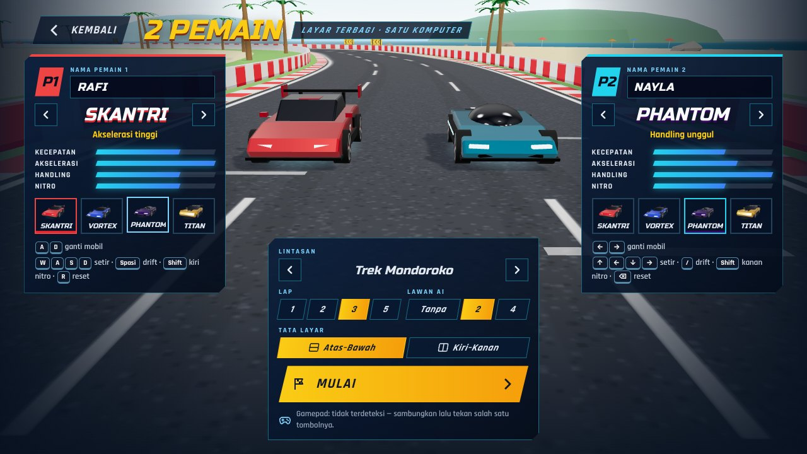
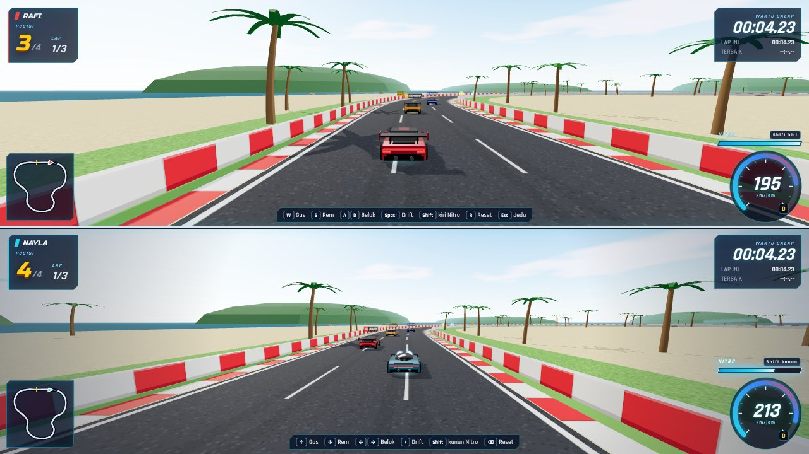
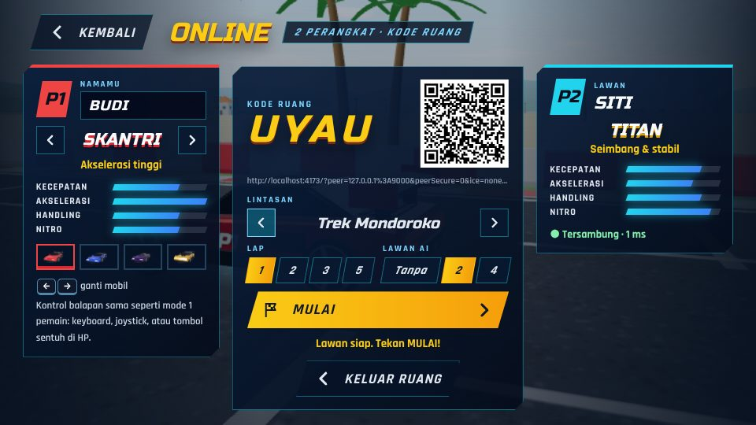
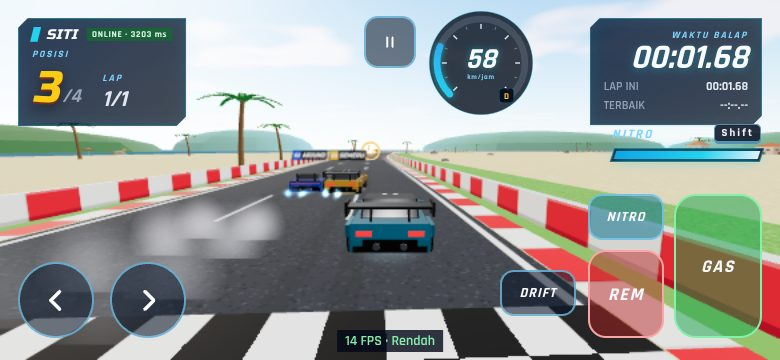

# SKANTRI RACE

**MANTAP — Mandiri Aktif Terampil dan Berprestasi**

Game balap mobil 3D bergaya arcade untuk browser, dibuat dengan **Three.js** dan **Vite**.
Semua model, tekstur, dekorasi, dan suara dibuat secara prosedural lewat kode (bebas hak cipta).

- **Pengembang:** Mohammad Yusron Kholish, S.Kom
- **Sekolah:** SMKS PGRI SINGOSARI


> **Status: Versi 1.2 — Tahap 3 + Multiplayer.** 4 mobil, 4 lintasan, nitro, 3 item bonus, 5 lawan AI,
> menu lengkap (Pilih Mobil, Pilih Lintasan, Pengaturan), efek suara, tombol layar sentuh, dan menu **MULTIPLAYER**:
> **SATU LAYAR** (layar terbagi, satu komputer) atau **DUA PERANGKAT** (online: laptop A + laptop B / HP, masuk dengan kode ruang atau QR).
> Tahap 4 (pengujian menyeluruh di perangkat nyata) menyusul.

| Pilih mobil | Pilih lintasan |
| --- | --- |
|  |  |
| **Kota Modern** | **Gurun 4D** |
|  |  |
| **Satu Layar — lobi** | **Satu Layar — layar terbagi** |
|  |  |
| **Online — lobi host (kode ruang + QR)** | **Online — tamu di HP (tombol sentuh)** |
|  |  |

---

## 1. Cara menjalankan

**Prasyarat:** Node.js **20.19 atau lebih baru** (disarankan Node.js 22 LTS) dan Google Chrome / Microsoft Edge terbaru.

```bash
npm install        # pasang dependensi (sekali saja, butuh internet)
npm run dev        # mode pengembangan → http://localhost:5173
npm run build      # versi siap-unggah ke folder dist/
npm run build:pages # versi siap-tayang GitHub Pages ke folder docs/
npm run preview    # coba hasil build → http://localhost:4173
npm test           # uji logika (lintasan, fisika, AI, item, nitro, balapan penuh)
```

Folder `dist/` bisa diunggah ke GitHub Pages, Netlify, atau hosting sekolah (jalur relatif `./`).
Font sudah dibundel, jadi game tetap tampil benar di lab yang offline.
Saat `npm run dev`, game bisa dibuka dari HP/laptop lain dalam satu jaringan lewat alamat **Network** di terminal.

---

### Publikasi ke GitHub Pages

Repositori ini sudah berisi **versi siap tayang** di folder `docs/` (hasil `npm run build:pages`), jadi tidak perlu build di GitHub.

1. Buat repositori baru di GitHub, mis. `skantrirace` (Public, **tanpa** README bawaan).
2. Unggah: klik **uploading an existing file**, lalu seret **seluruh isi** folder proyek (bukan foldernya) ke halaman unggah → **Commit changes**.
3. **Settings → Pages → Build and deployment**: Source **Deploy from a branch**, Branch **main**, folder **/docs** → **Save**.
4. Tunggu 1–2 menit. Game tayang di `https://<nama-akun>.github.io/skantrirace/`.

Setelah mengubah kode: jalankan `npm run build:pages`, lalu unggah ulang isi folder `docs/` (dan file sumber yang diubah).

Dengan Git (opsional):

```bash
git init -b main
git add .
git commit -m "SKANTRI RACE"
git remote add origin https://github.com/<nama-akun>/skantrirace.git
git push -u origin main
```

> Penting: jangan arahkan Pages ke folder **/(root)**. `index.html` di root adalah file sumber Vite yang belum di-build;
> yang siap tayang ada di `docs/`.

---

## 2. Kontrol

| Keyboard | Layar sentuh | Fungsi |
| --- | --- | --- |
| `W` / `↑` | GAS | Akselerasi |
| `S` / `↓` | REM | Rem — tahan saat berhenti untuk mundur |
| `A` `D` / `←` `→` | ◀ ▶ | Belok |
| `Spasi` | DRIFT | Rem tangan (drift juga mengisi nitro lebih cepat) |
| `Shift` | NITRO | Nitro |
| `R` | — | Kembalikan mobil ke tengah jalan |
| `M` | — | Bisukan / bunyikan suara |
| `Esc` / `P` | ❚❚ | Jeda |

Tombol sentuh muncul otomatis di tablet/HP (bisa dipaksa tampil atau dimatikan di **PENGATURAN**) dan mendukung multi-sentuh (gas + belok bersamaan).
Di menu: `←` `→` untuk berganti mobil/lintasan, `Enter` untuk memilih, `Esc` untuk kembali.
Gamepad USB/Bluetooth juga bisa dipakai (lihat tabel di bawah).

### Mode 2 Pemain (layar terbagi)

Menu utama → **MULTIPLAYER** → **SATU LAYAR**. Dua siswa bermain di **satu komputer**: layar dibagi dua, tiap pemain punya kamera, HUD, peta mini, nitro, dan tombolnya sendiri.

| | PEMAIN 1 (atas / kiri) | PEMAIN 2 (bawah / kanan) | Gamepad |
| --- | --- | --- | --- |
| Gas | `W` | `↑` | RT · A · D-pad atas |
| Rem / mundur | `S` | `↓` | LT · X · D-pad bawah |
| Belok | `A` `D` | `←` `→` | Stik kiri · D-pad |
| Drift | `Spasi` | `/` atau `.` | LB · Y |
| Nitro | `Shift` kiri | `Shift` kanan atau `Enter` | B · RB |
| Reset ke tengah jalan | `R` | `Backspace` | Back / Select |
| Jeda | `Esc` / `P` | `Esc` / `P` | Start |

- **Lobi 2 PEMAIN** (menu utama → *MULTIPLAYER* → *SATU LAYAR*): tiap pemain memilih mobil sendiri (`A`/`D` untuk P1, `←`/`→` untuk P2, atau klik),
  mengetik nama (maks. 12 karakter, tampil di HUD, papan nama di atas mobil, dan tabel hasil), lalu memilih lintasan,
  jumlah lap, **lawan AI** (tanpa / 2 / 4), dan **tata layar** (atas–bawah atau kiri–kanan). `Enter` = MULAI.
- **Gamepad:** 1 gamepad otomatis dipakai PEMAIN 2 (PEMAIN 1 tetap `W A S D`); 2 gamepad = P1 & P2. Tombol **TUKAR** di lobi menukar pemiliknya.
  Tekan salah satu tombol gamepad sekali agar browser mendeteksinya.
- **Hasil duel:** pemenang = posisi akhir yang lebih baik di antara kedua pemain (tidak finis = kalah). Bila keduanya tidak finis → **SERI**.
  Pemain yang finis lebih dulu dikemudikan autopilot sampai lawannya selesai; batas 60 detik setelah pembalap pertama finis tetap berlaku.
- Mobil PEMAIN 2 dicat **cyan** bernomor P2 agar tidak tertukar walau memilih model yang sama.
- Tombol sentuh tidak dipakai di mode ini (butuh keyboard dan/atau gamepad).

> **Tips lab komputer:** keyboard murah sering tidak bisa membaca banyak tombol sekaligus (*ghosting*), misalnya
> `W`+`A`+`Shift` dan `↑`+`←`+`Shift` ditekan bersamaan. Bila ada tombol yang "tidak terbaca", pakai gamepad untuk salah satu pemain.
> Mode ini menggambar adegan 2× per frame; pilih kualitas **Otomatis** atau **Rendah** di komputer lama.

### Mode Online — 2 perangkat (laptop A + laptop B / HP)

Dua siswa balapan di **perangkat masing-masing**, layar penuh, lewat internet (boleh beda jaringan, mis. Wi-Fi sekolah dan data seluler).

| Langkah | Perangkat A (host) | Perangkat B (tamu: laptop atau HP) |
| --- | --- | --- |
| 1 | Buka game → **MULTIPLAYER** → **DUA PERANGKAT** | Buka alamat game yang **sama** (mis. GitHub Pages) |
| 2 | Isi nama, pilih mobil → **BUAT RUANG** | **MULTIPLAYER** → **DUA PERANGKAT** → ketik **kode 4 huruf** → **GABUNG** |
| 3 | Muncul **kode ruang** (mis. `K7QM`), **QR**, dan tautan undangan | …atau cukup **pindai QR** dengan kamera HP / buka tautan undangan → langsung masuk ruang |
| 4 | Pilih lintasan, jumlah lap, lawan AI (tanpa / 2 / 4) → **MULAI** | Pilih mobil & nama, tunggu host menekan MULAI |

- Kendali tiap perangkat = kendali 1 pemain biasa: keyboard (`W A S D` / panah), gamepad, atau **tombol sentuh** di HP.
- Lobi menampilkan nama, mobil, dan **ping** lawan; HUD balapan menampilkan `ONLINE · xx ms` (merah = sinyal lemah).
- `Esc` / tombol ❚❚ membuka menu kecil, tetapi **balapan online tidak dijeda** (lawan tetap melaju).
- Layar hasil sama di kedua perangkat (pemenang duel = posisi akhir lebih baik). Hanya host yang bisa **MAIN LAGI** atau
  kembali ke **LOBI ONLINE**; tamu ikut otomatis.
- Bila lawan keluar/terputus (tidak ada data 15 detik), balapan tetap lanjut melawan AI dan lawan dicatat **tidak finis**;
  ruang host tetap terbuka sehingga tamu bisa masuk lagi dengan kode yang sama. Bila host keluar, tamu kembali ke layar online dengan pesan.
- Satu ruang = 2 pemain manusia (+ AI). Perangkat ketiga ditolak (*Ruang sudah penuh*). Kedua perangkat harus memakai versi game yang sama.

**Cara kerjanya (bisa dijadikan bahan ajar jaringan):** kedua browser "bertemu" lewat *server sinyal* PeerJS publik gratis
(`0.peerjs.com`) memakai kode ruang, lalu data balapan dikirim **langsung antar-perangkat** dengan WebRTC (*peer-to-peer*), ±20 paket/detik.
Bila koneksi langsung diblokir NAT/firewall, PeerJS memakai server relay TURN publiknya. Host menjalankan aturan balapan (hitung mundur,
lap, posisi, AI, item); tiap perangkat menjalankan fisika mobilnya sendiri agar kendali terasa tanpa jeda, sedangkan mobil lawan
diperkirakan dari kecepatannya (*dead reckoning*) lalu dihaluskan. Yang dikirim hanya nama, pilihan mobil, dan posisi/kecepatan mobil —
tanpa akun, tanpa data pribadi lain.

> **Syarat & catatan jaringan sekolah:** kedua perangkat perlu internet dan game sebaiknya dibuka lewat **https** (GitHub Pages).
> Jaringan yang memblokir WebRTC/UDP atau situs `peerjs.com` membuat ruang tidak bisa dibuat/dimasuki — coba hotspot HP.
> Server sinyal publik gratis tidak bergaransi. Untuk **lab tanpa internet** (satu Wi-Fi/LAN), jalankan server sinyal sendiri
> di komputer guru: `npx peer --port 9000` (paket `peer` diunduh sekali saat masih ada internet) dan `npm run dev`, lalu buka game
> di semua perangkat dengan `?peer=<IP-komputer-guru>:9000&peerSecure=0`, mis. `http://192.168.1.10:5173/?peer=192.168.1.10:9000&peerSecure=0`.
> Tautan undangan/QR ikut membawa pengaturan ini.

---

## 3. Isi game

### Mobil

| Mobil | Keunggulan | Kecepatan maks | + Nitro | Ciri model |
| --- | --- | --- | --- | --- |
| **SKANTRI** | Akselerasi tertinggi | 205 km/j | 248 km/j | Bodi baji, sayap belakang tinggi |
| **VORTEX** | Kecepatan maksimum tertinggi | 223 km/j | 274 km/j | Hypercar panjang-rendah, sirip kembar |
| **PHANTOM** | Handling terbaik (paling cepat di tikungan) | 202 km/j | 241 km/j | Kanopi gelembung, side pod neon |
| **TITAN** | Seimbang & stabil: paling berat, tangki nitro terbesar, tidak banyak melambat saat menyentuh pembatas | 211 km/j | 254 km/j | GT kekar, spakbor lebar, sayap GT |

Keseimbangan sudah diuji lewat simulasi: dengan pengemudi yang sama, selisih waktu lap antar-mobil < 3 %, dan tiap mobil
unggul di medannya (PHANTOM di Kota & Pegunungan yang berliku, VORTEX di Gurun yang cepat).

### Lintasan

| Lintasan | Tema | Panjang | Ciri khas |
| --- | --- | --- | --- |
| **Trek Mondoroko** | Pantai tropis | 1,58 km | Tikungan lebar, 1 ramp, mercusuar, rumah pesisir |
| **Kota Modern** | Kota saat senja | 1,63 km | Tikungan siku, chicane, gedung tinggi berjendela menyala, lampu jalan, reklame neon |
| **Pegunungan** | Hutan pinus | 1,31 km | Hairpin tajam (R ±21 m), tanjakan sampai 7 m, **jembatan** di atas sungai, tebing batu |
| **Gurun 4D** | Gurun batu | 1,68 km | 3 ramp, 4 **portal futuristik**, mesa berlapis, gapura batu, kaktus |

Semua lintasan benar-benar dapat dibalapi (AI menyelesaikan balapan penuh di keempatnya dalam uji otomatis).

### Nitro & item

| | Efek nyata pada fisika | Durasi | Cooldown |
| --- | --- | --- | --- |
| **Nitro** (`Shift`) | Dorongan +19–20 m/s², kecepatan maks naik +11–14 m/s | Tangki 2,8–3,8 dtk | Terisi pelan sendiri; lebih cepat saat drift. Setelah habis, terkunci sampai terisi 15 % |
| **SPEED ORB** (bola kuning) | Dorongan +10 m/s seketika, kecepatan maks +9 m/s, bonus isi nitro | 2,5 dtk | 5 dtk per mobil · muncul lagi 8 dtk |
| **SHIELD** (kristal biru) | Tidak melambat saat menabrak pembatas; mobil lain terpental (massa ×4) | 6 dtk | 10 dtk per mobil · muncul lagi 10 dtk |
| **TURBO RING** (cincin oranye) | Akselerasi ×1,9, kecepatan maks +5 m/s | 3 dtk | 3 dtk per mobil · muncul lagi 4 dtk |

*Cooldown per mobil:* item sejenis dilewati (tidak terambil) selama cooldown-mu belum habis, sehingga tetap tersedia untuk pembalap lain.
Lawan AI juga memakai nitro (hanya di lurusan yang cukup panjang untuk mengerem) dan mengincar item di jalurnya.

### Balapan

- 1, 2, 3, atau 5 lap (default 3) melawan 5 pembalap komputer: ARJUNO (VORTEX), SEMERU (TITAN), BROMO (PHANTOM), KAWI (SKANTRI), PANDERMAN (TITAN).
- Pemain mulai dari barisan paling belakang. Countdown 3-2-1-GO! dengan lampu start; mobil terkunci sampai lampu hijau.
- Lap sah setelah melewati 3 checkpoint lalu garis START/FINIS.

| Hasil | Syarat |
| --- | --- |
| **MENANG!** | Finis di posisi 1 |
| **PODIUM!** | Finis di posisi 2 atau 3 |
| **KALAH** | Finis di posisi 4–6, atau tidak finis dalam 60 detik setelah pemenang finis |

**LATIHAN BEBAS:** sendirian di lintasan yang dipilih, untuk mengejar waktu lap terbaik.

**MULTIPLAYER:** duel dua siswa (dengan atau tanpa lawan AI) di satu komputer (*SATU LAYAR*) atau di dua perangkat lewat internet
(*DUA PERANGKAT*) — lihat *Mode 2 Pemain* dan *Mode Online* di bagian Kontrol.

### Pengaturan (tersimpan otomatis di browser)

| Pilihan | Nilai |
| --- | --- |
| Tingkat kesulitan | Mudah · Normal · Sulit |
| Jumlah lap | 1 · 2 · 3 · 5 |
| Kualitas grafis | **Otomatis** (turun/naik sendiri sesuai FPS) · Rendah (tanpa bayangan, resolusi 75 %) · Sedang · Tinggi |
| Tombol sentuh | Otomatis · Selalu · Mati |
| Volume suara | 0–100 % |
| Tampilkan FPS | Ya / Tidak |

Hasil kalibrasi kesulitan (simulasi pengemudi bot bertombol keyboard di 4 lintasan): di **Mudah** pemula pun bisa juara,
di **Normal** perlu kemampuan sedang, di **Sulit** perlu kemampuan baik. Bot mengantisipasi tikungan dengan sempurna,
jadi siswa sungguhan kemungkinan sedikit di bawahnya — sesuaikan tingkat kesulitan di kelas.

---

## 4. Struktur proyek

```
skantri-race/
├─ index.html
├─ src/
│  ├─ main.js                   Titik masuk: cek WebGL 2, muat font, buat Game
│  ├─ style.css                 Gaya antarmuka
│  ├─ assets/logo-smks-pgri-singosari.png
│  ├─ net/                      Mode online 2 perangkat
│  │  ├─ protocol.js            Kode ruang, format paket, mobil jarak jauh (dead reckoning + penghalusan)
│  │  ├─ NetLink.js             Sambungan WebRTC lewat PeerJS (buat/masuk ruang, ping, putus-sambung)
│  │  ├─ OnlineSession.js       Alur lobi online: profil, pilihan host, mulai, snapshot 20×/detik
│  │  └─ RaceMirror.js          Salinan aturan balapan di perangkat tamu (mengikuti host)
│  ├─ game/
│  │  ├─ Game.js                Pengendali utama: renderer, alur menu/balapan, layar terbagi & online, kualitas grafis, partikel
│  │  ├─ Physics.js             Fisika arcade murni (nitro, efek item, tanjakan, tabrakan pembatas & antar-mobil)
│  │  ├─ TrackPath.js           Matematika lintasan: sampel kurva, proyeksi, ramp, kemiringan
│  │  ├─ Track.js               Mesh lintasan: jalan, pembatas per tema, tanggul, jembatan & sungai, ramp, tanah
│  │  ├─ scenery/               Dekorasi per tema: tropis.js, kota.js, gunung.js, gurun.js (+ common.js)
│  │  ├─ CarModels.js           4 model mobil prosedural
│  │  ├─ Vehicle.js             Mobil = fisika + model + papan nama + gelembung perisai
│  │  ├─ AIRacer.js             Otak AI: jalur, tikungan, jaga jarak, menyalip, nitro, incar item
│  │  ├─ ItemSystem.js          Logika item (ambil, efek, respawn, cooldown)
│  │  ├─ ItemVisuals.js         Tampilan item di lintasan
│  │  ├─ Particles.js           Api nitro/turbo, asap drift, percikan item
│  │  ├─ RaceManager.js         Countdown, checkpoint, lap, posisi, finis, batas waktu
│  │  ├─ ChaseCamera.js         Kamera pengejar (FOV menyesuaikan layar terbagi), kamera menu, orbit garasi, lobi
│  │  ├─ Input.js               Keyboard (peta tombol 1 & 2 pemain), tombol sentuh, gamepad
│  │  ├─ Audio.js · Settings.js · textures.js
│  │  └─ data/                  cars.js · tracks.js · racers.js · items.js
│  └─ ui/
│     ├─ Menu.js                Utama, Multiplayer (Satu Layar / Dua Perangkat + QR), Pilih Mobil, Pilih Lintasan, Pengaturan, Petunjuk, Jeda, Hasil
│     ├─ HUD.js                 Speedometer, posisi, klasemen, nitro, efek item, minimap (satu panel per pemain)
│     ├─ TouchControls.js       Tombol layar sentuh
│     └─ SpeedLines.js          Garis kecepatan saat nitro
├─ tests/
│  ├─ logic.test.mjs            Uji logika (npm test)
│  ├─ simulateRace.mjs          Simulasi balapan tanpa grafis (node tests/simulateRace.mjs)
│  ├─ browser.test.mjs          Uji browser otomatis (opsional, butuh Playwright)
│  └─ online.test.mjs           Uji online 2 perangkat: laptop + HP teremulasi (opsional, butuh Playwright + peer)
├─ docs/                        Versi siap tayang untuk GitHub Pages (hasil npm run build:pages)
└─ media/                       Screenshot README
```

### Menambah lintasan

Lintasan adalah data di `src/game/data/tracks.js`: titik kontrol `[x, z, y?]`, lebar, ramp, item, jembatan, portal, dan tema
(`tropis` / `kota` / `gunung` / `gurun`). Jalankan `npm test` sesudahnya: uji menolak tikungan terlalu sempit,
bagian lintasan yang saling bersinggungan, grid start yang tidak lurus, item di luar jalan, dan memeriksa AI bisa menyelesaikan balapan.

---

## 5. Mode debug

Buka dengan `?debug=1` (mis. `http://localhost:5173/?debug=1`):

- FPS & tingkat kualitas aktif tampil di kanan atas.
- Konsol browser: `__skantri.snapshot()` (status lengkap, termasuk `players` di mode 2 pemain dan `net` di mode online: kode ruang, ping, jumlah paket), `__skantri.timeScale = 0.25` (gerak lambat untuk menjelaskan fisika di kelas).

---

## 6. Hasil pengujian (Versi 1.2 — Tahap 3 + Multiplayer)

Pengujian dijalankan sungguhan, bukan diasumsikan:

| Uji | Hasil |
| --- | --- |
| `npm run build` | Berhasil (pustaka online PeerJS dimuat terpisah, hanya saat menu DUA PERANGKAT dipakai) |
| `npm test` — uji logika | **40/40 lolos** — Tahap 1–2 (lintasan, fisika, pembatas, ramp, lap, countdown, AI, tabrakan antar-mobil, menang/kalah) + Tahap 3: keempat lintasan valid; karakter mobil; nitro; ketiga item berefek nyata + respawn + cooldown; tanjakan & jembatan; **balapan penuh di 4 lintasan × 4 mobil pemain**; mobil berat mendorong lebih kuat · **Satu Layar:** peta tombol P1/P2 terpisah, reset per pemain, mengetik nama tidak menggerakkan mobil, gamepad & TUKAR, pengaturan rusak kembali ke bawaan, peringkat 2 pembalap manusia · **Online:** kode ruang (tanpa huruf mirip I/O/0/1, huruf kecil & spasi dirapikan), opsi server sendiri lewat URL, paket mobil ringkas bolak-balik tanpa kehilangan arti, penghalusan mobil jarak jauh (selisih < 1,5 m, lompatan > 8 m langsung dipindah), mobil jarak jauh tidak terdorong saat tabrakan, item yang diambil perangkat lain, **klasemen salinan di tamu = klasemen host** |
| `npm run test:browser` — Chromium headless | **120/120 lolos, 0 error konsol** — semua uji Tahap 1–3 (menu, pengaturan tersimpan, garasi, 4 lintasan tanpa kebocoran memori, nitro, Shield, tombol sentuh) + **Satu Layar** (menu MULTIPLAYER → SATU LAYAR, lobi, layar terbagi atas–bawah & kiri–kanan, kontrol P1/P2 terpisah, gamepad tiruan, hasil duel, SERI, kembali ke 1 pemain, tanpa kebocoran memori) |
| `npm run test:online` — 2 browser: host laptop 960×540 (keyboard) + tamu **HP teremulasi** 780×360 (sentuh) | **45/45 lolos, 0 error konsol** — menu MULTIPLAYER → DUA PERANGKAT; kode salah/kurang → pesan jelas; BUAT RUANG → kode + QR + tautan; tamu masuk lewat tautan **dan** lewat ketik kode; nama, mobil, lintasan, lap & jumlah AI tersinkron; perangkat ketiga ditolak (*ruang penuh*); MULAI serentak; mobil diam saat hitung mundur; GAS sentuh di HP & `W` di laptop menggerakkan mobil masing-masing dan **terlihat bergerak di perangkat lawan**; AI terlihat di tamu; klasemen kedua perangkat sama; item yang diambil tamu hilang di host; Esc tidak menjeda balapan online; balapan selesai → **pemenang sama di kedua perangkat**, tabel menandai (KAMU)/(P1)/(P2); layar hasil HP muat tanpa digulir; MAIN LAGI & LOBI ONLINE dari host diikuti tamu; tamu keluar di tengah balapan → host lanjut, tamu tidak finis, ruang tetap terbuka; host keluar → tamu diberi tahu |
| Tata letak | Menu utama muat di 412×860 s.d. 1920×1080; tidak ada elemen HUD yang tertutup tombol sentuh; lobi Satu Layar rapi di 900×420 (bisa digulir) s.d. 1920×1080; lobi online & layar hasil online diperiksa di 960×540 dan HP mendatar 780×360 |
| Simulasi penyetelan | `node tests/simulateRace.mjs` — balapan 6 AI di tiap lintasan; keseimbangan mobil < 3 %; kalibrasi kesulitan dengan bot keyboard |

**Catatan jujur tentang mode online:** uji online memakai **server sinyal PeerJS lokal** (protokolnya sama dengan server publik
`0.peerjs.com`) dan dua browser di satu server, karena server pengujian tidak bisa mengakses internet. Yang **belum** diuji:
koneksi lewat server publik PeerJS, lewat internet sungguhan (NAT/firewall sekolah, data seluler), dan di laptop/HP fisik.
Ping 1 ms – beberapa detik di laporan uji disebabkan server uji yang sangat lambat, bukan jaringan; di jaringan nyata wajarnya 20–150 ms.
Uji pertama di sekolah disarankan: dua perangkat membuka versi GitHub Pages, satu BUAT RUANG, satu GABUNG.

**Catatan jujur tentang performa:** server pengujian tidak punya GPU (WebGL dirender software oleh SwiftShader di 2 core CPU),
sehingga sangat lambat (±1–4 detik per frame saat balapan 6 mobil). Angka itu **tidak mewakili** komputer dengan GPU.
Beban adegan saat balapan ±70–92 ribu segitiga dan ±270 draw call — wajar untuk GPU terintegrasi modern — tetapi FPS
di perangkat nyata belum diukur. Mode **Satu Layar** menggambar adegan dua kali per frame (beban GPU ±2×); mode **online**
hanya sekali per perangkat. Mode grafis **Otomatis** menurunkan kualitas sendiri bila FPS < 38. Gamepad baru diuji dengan
gamepad tiruan (Gamepad API disimulasikan), belum dengan gamepad fisik. Pengukuran di komputer lab dijadwalkan di Tahap 4.

### Menjalankan uji browser sendiri (opsional)

```bash
npm i -D playwright
npx playwright install chromium
npm run build
npm run preview          # terminal 1
npm run test:browser     # terminal 2 — screenshot tersimpan di tests/screenshots/

npm i -D peer            # sekali, untuk uji online (server sinyal lokal, tanpa internet)
npm run test:online      # terminal 2 — host laptop + tamu HP teremulasi
```

---

## 7. Rencana Tahap 4

- Uji di komputer lab & HP sungguhan: FPS tiap lintasan per tingkat kualitas (termasuk mode 2 pemain), kontrol sentuh di beberapa ukuran layar,
  mode online lewat Wi-Fi sekolah dan data seluler (ping, putus-sambung),
  gamepad fisik (Xbox/PlayStation/USB generik) dan keyboard lab (cek *ghosting* saat 2 pemain).
- Uji main oleh siswa → setel ulang tingkat kesulitan berdasarkan data nyata.
- Uji menyeluruh semua kontrol, tabrakan, perpindahan lintasan, kondisi menang/kalah.

---

## 8. Identitas & lisensi aset

- Nama pengembang dan sekolah diatur di satu tempat: konstanta `CREDIT` di `src/ui/Menu.js`.
- Logo SMKS PGRI SINGOSARI: milik sekolah, dipakai untuk identitas media pembelajaran ini (`src/assets/`).
- Model 3D, tekstur, dekorasi, dan efek suara: dibuat prosedural di dalam kode proyek ini.
- Font *Russo One* dan *Rajdhani*: SIL Open Font License 1.1 (paket `@fontsource`). Three.js & Vite: lisensi MIT.
- Nama & desain mobil, lintasan, dan teks reklame orisinal; nama lawan diambil dari gunung di sekitar Malang.
