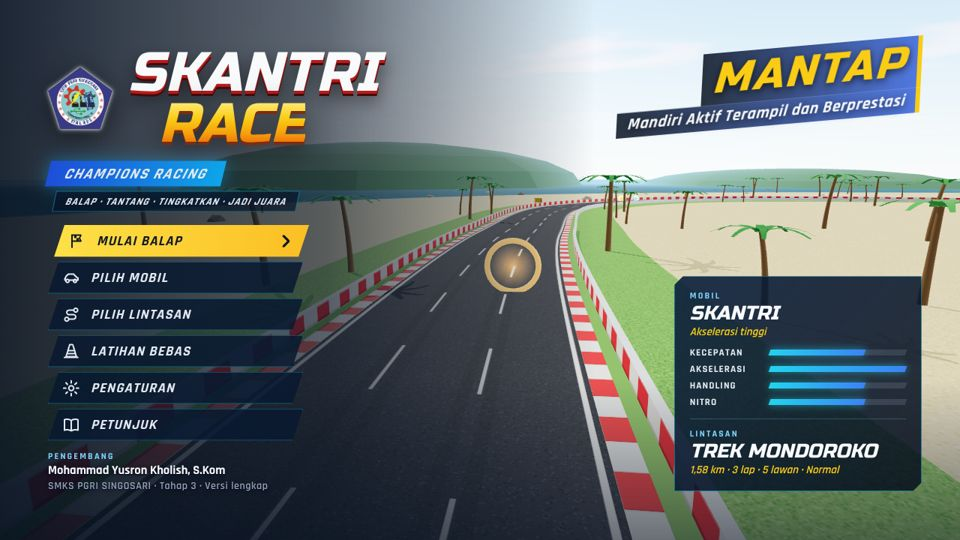
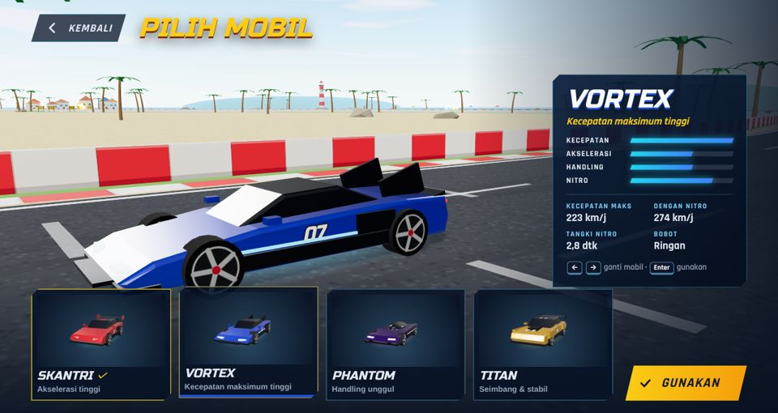
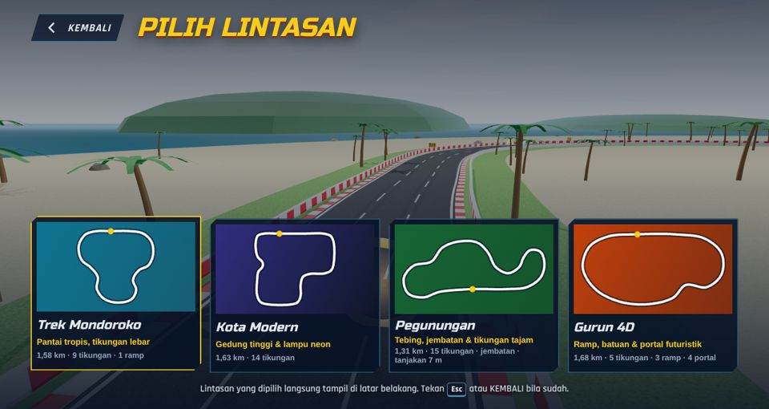
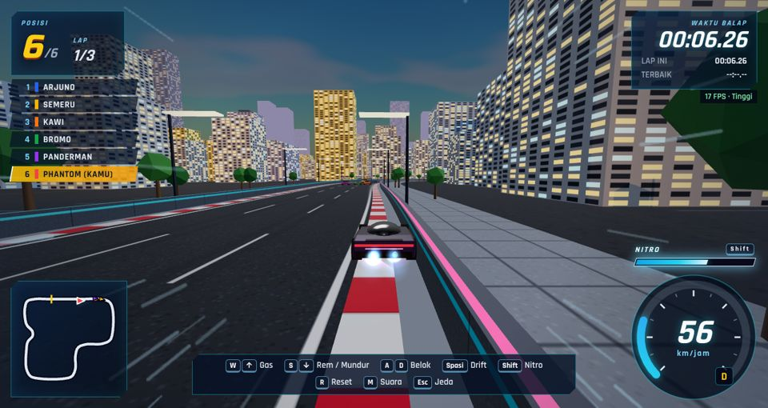
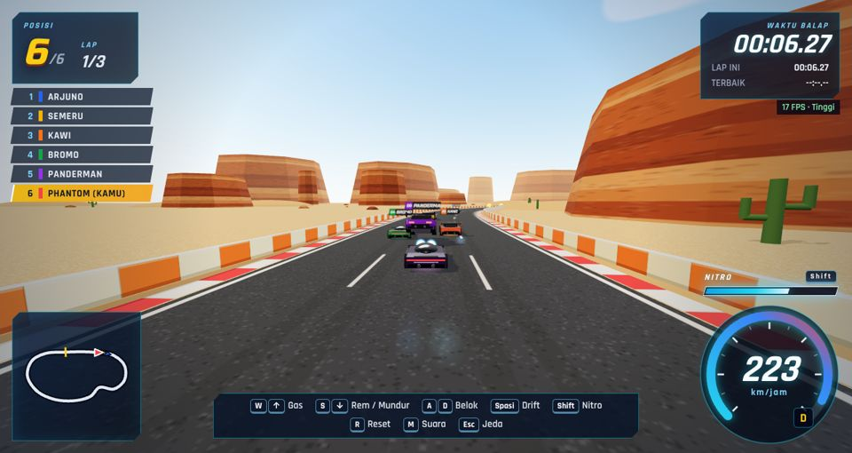

# SKANTRI RACE

**MANTAP — Mandiri Aktif Terampil dan Berprestasi**

Game balap mobil 3D bergaya arcade untuk browser, dibuat dengan **Three.js** dan **Vite**.
Semua model, tekstur, dekorasi, dan suara dibuat secara prosedural lewat kode (bebas hak cipta).

- **Pengembang:** Mohammad Yusron Kholish, S.Kom
- **Sekolah:** SMKS PGRI SINGOSARI



> **Status: Tahap 3 — versi lengkap.** 4 mobil, 4 lintasan, nitro, 3 item bonus, 5 lawan AI,
> menu lengkap (Pilih Mobil, Pilih Lintasan, Pengaturan), efek suara, dan tombol layar sentuh.
> Tahap 4 (pengujian menyeluruh di perangkat nyata) menyusul.

| Pilih mobil | Pilih lintasan |
| --- | --- |
|  |  |
| **Kota Modern** | **Gurun 4D** |
|  |  |

---

## 1. Cara menjalankan

**Prasyarat:** Node.js **20.19 atau lebih baru** (disarankan Node.js 22 LTS) dan Google Chrome / Microsoft Edge terbaru.

```bash
npm install        # pasang dependensi (sekali saja, butuh internet)
npm run dev        # mode pengembangan → http://localhost:5173
npm run build      # versi siap-unggah ke folder dist/
npm run build:pages # versi siap-tayang GitHub Pages ke folder docs/
npm run preview    # coba hasil build → http://localhost:4173
npm test           # uji logika (lintasan, fisika, AI, item, nitro, balapan penuh)
```

Folder `dist/` bisa diunggah ke GitHub Pages, Netlify, atau hosting sekolah (jalur relatif `./`).
Font sudah dibundel, jadi game tetap tampil benar di lab yang offline.
Saat `npm run dev`, game bisa dibuka dari HP/laptop lain dalam satu jaringan lewat alamat **Network** di terminal.

---

### Publikasi ke GitHub Pages

Repositori ini sudah berisi **versi siap tayang** di folder `docs/` (hasil `npm run build:pages`), jadi tidak perlu build di GitHub.

1. Buat repositori baru di GitHub, mis. `skantrirace` (Public, **tanpa** README bawaan).
2. Unggah: klik **uploading an existing file**, lalu seret **seluruh isi** folder proyek (bukan foldernya) ke halaman unggah → **Commit changes**.
3. **Settings → Pages → Build and deployment**: Source **Deploy from a branch**, Branch **main**, folder **/docs** → **Save**.
4. Tunggu 1–2 menit. Game tayang di `https://<nama-akun>.github.io/skantrirace/`.

Setelah mengubah kode: jalankan `npm run build:pages`, lalu unggah ulang isi folder `docs/` (dan file sumber yang diubah).

Dengan Git (opsional):

```bash
git init -b main
git add .
git commit -m "SKANTRI RACE"
git remote add origin https://github.com/<nama-akun>/skantrirace.git
git push -u origin main
```

> Penting: jangan arahkan Pages ke folder **/(root)**. `index.html` di root adalah file sumber Vite yang belum di-build;
> yang siap tayang ada di `docs/`.

---

## 2. Kontrol

| Keyboard | Layar sentuh | Fungsi |
| --- | --- | --- |
| `W` / `↑` | GAS | Akselerasi |
| `S` / `↓` | REM | Rem — tahan saat berhenti untuk mundur |
| `A` `D` / `←` `→` | ◀ ▶ | Belok |
| `Spasi` | DRIFT | Rem tangan (drift juga mengisi nitro lebih cepat) |
| `Shift` | NITRO | Nitro |
| `R` | — | Kembalikan mobil ke tengah jalan |
| `M` | — | Bisukan / bunyikan suara |
| `Esc` / `P` | ❚❚ | Jeda |

Tombol sentuh muncul otomatis di tablet/HP (bisa dipaksa tampil atau dimatikan di **PENGATURAN**) dan mendukung multi-sentuh (gas + belok bersamaan).
Di menu: `←` `→` untuk berganti mobil/lintasan, `Enter` untuk memilih, `Esc` untuk kembali.

---

## 3. Isi game

### Mobil

| Mobil | Keunggulan | Kecepatan maks | + Nitro | Ciri model |
| --- | --- | --- | --- | --- |
| **SKANTRI** | Akselerasi tertinggi | 205 km/j | 248 km/j | Bodi baji, sayap belakang tinggi |
| **VORTEX** | Kecepatan maksimum tertinggi | 223 km/j | 274 km/j | Hypercar panjang-rendah, sirip kembar |
| **PHANTOM** | Handling terbaik (paling cepat di tikungan) | 202 km/j | 241 km/j | Kanopi gelembung, side pod neon |
| **TITAN** | Seimbang & stabil: paling berat, tangki nitro terbesar, tidak banyak melambat saat menyentuh pembatas | 211 km/j | 254 km/j | GT kekar, spakbor lebar, sayap GT |

Keseimbangan sudah diuji lewat simulasi: dengan pengemudi yang sama, selisih waktu lap antar-mobil < 3 %, dan tiap mobil
unggul di medannya (PHANTOM di Kota & Pegunungan yang berliku, VORTEX di Gurun yang cepat).

### Lintasan

| Lintasan | Tema | Panjang | Ciri khas |
| --- | --- | --- | --- |
| **Trek Mondoroko** | Pantai tropis | 1,58 km | Tikungan lebar, 1 ramp, mercusuar, rumah pesisir |
| **Kota Modern** | Kota saat senja | 1,63 km | Tikungan siku, chicane, gedung tinggi berjendela menyala, lampu jalan, reklame neon |
| **Pegunungan** | Hutan pinus | 1,31 km | Hairpin tajam (R ±21 m), tanjakan sampai 7 m, **jembatan** di atas sungai, tebing batu |
| **Gurun 4D** | Gurun batu | 1,68 km | 3 ramp, 4 **portal futuristik**, mesa berlapis, gapura batu, kaktus |

Semua lintasan benar-benar dapat dibalapi (AI menyelesaikan balapan penuh di keempatnya dalam uji otomatis).

### Nitro & item

| | Efek nyata pada fisika | Durasi | Cooldown |
| --- | --- | --- | --- |
| **Nitro** (`Shift`) | Dorongan +19–20 m/s², kecepatan maks naik +11–14 m/s | Tangki 2,8–3,8 dtk | Terisi pelan sendiri; lebih cepat saat drift. Setelah habis, terkunci sampai terisi 15 % |
| **SPEED ORB** (bola kuning) | Dorongan +10 m/s seketika, kecepatan maks +9 m/s, bonus isi nitro | 2,5 dtk | 5 dtk per mobil · muncul lagi 8 dtk |
| **SHIELD** (kristal biru) | Tidak melambat saat menabrak pembatas; mobil lain terpental (massa ×4) | 6 dtk | 10 dtk per mobil · muncul lagi 10 dtk |
| **TURBO RING** (cincin oranye) | Akselerasi ×1,9, kecepatan maks +5 m/s | 3 dtk | 3 dtk per mobil · muncul lagi 4 dtk |

*Cooldown per mobil:* item sejenis dilewati (tidak terambil) selama cooldown-mu belum habis, sehingga tetap tersedia untuk pembalap lain.
Lawan AI juga memakai nitro (hanya di lurusan yang cukup panjang untuk mengerem) dan mengincar item di jalurnya.

### Balapan

- 1, 2, 3, atau 5 lap (default 3) melawan 5 pembalap komputer: ARJUNO (VORTEX), SEMERU (TITAN), BROMO (PHANTOM), KAWI (SKANTRI), PANDERMAN (TITAN).
- Pemain mulai dari barisan paling belakang. Countdown 3-2-1-GO! dengan lampu start; mobil terkunci sampai lampu hijau.
- Lap sah setelah melewati 3 checkpoint lalu garis START/FINIS.

| Hasil | Syarat |
| --- | --- |
| **MENANG!** | Finis di posisi 1 |
| **PODIUM!** | Finis di posisi 2 atau 3 |
| **KALAH** | Finis di posisi 4–6, atau tidak finis dalam 60 detik setelah pemenang finis |

**LATIHAN BEBAS:** sendirian di lintasan yang dipilih, untuk mengejar waktu lap terbaik.

### Pengaturan (tersimpan otomatis di browser)

| Pilihan | Nilai |
| --- | --- |
| Tingkat kesulitan | Mudah · Normal · Sulit |
| Jumlah lap | 1 · 2 · 3 · 5 |
| Kualitas grafis | **Otomatis** (turun/naik sendiri sesuai FPS) · Rendah (tanpa bayangan, resolusi 75 %) · Sedang · Tinggi |
| Tombol sentuh | Otomatis · Selalu · Mati |
| Volume suara | 0–100 % |
| Tampilkan FPS | Ya / Tidak |

Hasil kalibrasi kesulitan (simulasi pengemudi bot bertombol keyboard di 4 lintasan): di **Mudah** pemula pun bisa juara,
di **Normal** perlu kemampuan sedang, di **Sulit** perlu kemampuan baik. Bot mengantisipasi tikungan dengan sempurna,
jadi siswa sungguhan kemungkinan sedikit di bawahnya — sesuaikan tingkat kesulitan di kelas.

---

## 4. Struktur proyek

```
skantri-race/
├─ index.html
├─ src/
│  ├─ main.js                   Titik masuk: cek WebGL 2, muat font, buat Game
│  ├─ style.css                 Gaya antarmuka
│  ├─ assets/logo-smks-pgri-singosari.png
│  ├─ game/
│  │  ├─ Game.js                Pengendali utama: renderer, alur menu/balapan, kualitas grafis, partikel
│  │  ├─ Physics.js             Fisika arcade murni (nitro, efek item, tanjakan, tabrakan pembatas & antar-mobil)
│  │  ├─ TrackPath.js           Matematika lintasan: sampel kurva, proyeksi, ramp, kemiringan
│  │  ├─ Track.js               Mesh lintasan: jalan, pembatas per tema, tanggul, jembatan & sungai, ramp, tanah
│  │  ├─ scenery/               Dekorasi per tema: tropis.js, kota.js, gunung.js, gurun.js (+ common.js)
│  │  ├─ CarModels.js           4 model mobil prosedural
│  │  ├─ Vehicle.js             Mobil = fisika + model + papan nama + gelembung perisai
│  │  ├─ AIRacer.js             Otak AI: jalur, tikungan, jaga jarak, menyalip, nitro, incar item
│  │  ├─ ItemSystem.js          Logika item (ambil, efek, respawn, cooldown)
│  │  ├─ ItemVisuals.js         Tampilan item di lintasan
│  │  ├─ Particles.js           Api nitro/turbo, asap drift, percikan item
│  │  ├─ RaceManager.js         Countdown, checkpoint, lap, posisi, finis, batas waktu
│  │  ├─ ChaseCamera.js         Kamera pengejar, kamera menu, orbit garasi
│  │  ├─ Input.js · Audio.js · Settings.js · textures.js
│  │  └─ data/                  cars.js · tracks.js · racers.js · items.js
│  └─ ui/
│     ├─ Menu.js                Utama, Pilih Mobil, Pilih Lintasan, Pengaturan, Petunjuk, Jeda, Hasil
│     ├─ HUD.js                 Speedometer, posisi, klasemen, nitro, efek item, minimap
│     ├─ TouchControls.js       Tombol layar sentuh
│     └─ SpeedLines.js          Garis kecepatan saat nitro
├─ tests/
│  ├─ logic.test.mjs            Uji logika (npm test)
│  ├─ simulateRace.mjs          Simulasi balapan tanpa grafis (node tests/simulateRace.mjs)
│  └─ browser.test.mjs          Uji browser otomatis (opsional, butuh Playwright)
├─ docs/                        Versi siap tayang untuk GitHub Pages (hasil npm run build:pages)
└─ media/                       Screenshot README
```

### Menambah lintasan

Lintasan adalah data di `src/game/data/tracks.js`: titik kontrol `[x, z, y?]`, lebar, ramp, item, jembatan, portal, dan tema
(`tropis` / `kota` / `gunung` / `gurun`). Jalankan `npm test` sesudahnya: uji menolak tikungan terlalu sempit,
bagian lintasan yang saling bersinggungan, grid start yang tidak lurus, item di luar jalan, dan memeriksa AI bisa menyelesaikan balapan.

---

## 5. Mode debug

Buka dengan `?debug=1` (mis. `http://localhost:5173/?debug=1`):

- FPS & tingkat kualitas aktif tampil di kanan atas.
- Konsol browser: `__skantri.snapshot()` (status lengkap), `__skantri.timeScale = 0.25` (gerak lambat untuk menjelaskan fisika di kelas).

---

## 6. Hasil pengujian Tahap 3

Pengujian dijalankan sungguhan, bukan diasumsikan:

| Uji | Hasil |
| --- | --- |
| `npm run build` | Berhasil |
| `npm test` — uji logika | **27/27 lolos** — Tahap 1–2 (lintasan, fisika, pembatas, ramp, lap, countdown, AI, tabrakan antar-mobil, menang/kalah) + Tahap 3: keempat lintasan valid; karakter mobil (VORTEX tercepat, SKANTRI akselerasi terbaik, TITAN terberat, PHANTOM lebih cepat dari VORTEX di lintasan berliku); nitro (dorongan, kapasitas tangki, isi ulang, kunci saat habis); ketiga item berefek nyata + respawn + cooldown; tanjakan & jembatan Pegunungan; **balapan penuh di 4 lintasan × 4 mobil pemain** (semua finis, AI tidak macet, tidak menembus pembatas, item & nitro dipakai); mobil berat mendorong lebih kuat |
| `npm run test:browser` — Chromium headless | **80/80 lolos, 0 error konsol** — semua uji Tahap 1–2 + menu 6 pilihan; pengaturan diterapkan & tetap tersimpan setelah halaman dimuat ulang; garasi (gambar mini 3D, ganti 4 mobil, batal, GUNAKAN); ganti 4 lintasan tanpa kebocoran geometri/tekstur; balapan di Gurun 4D dengan TITAN; nitro (meter HUD, garis kecepatan, 251 km/j > maks normal 211); Shield (indikator HUD, item hilang lalu muncul lagi); kolom MOBIL di layar hasil; **tombol sentuh** di perangkat sentuh teremulasi (gas, belok + gas bersamaan, rem, jeda) |
| Tata letak | Menu utama muat di 412×860 s.d. 1920×1080; tidak ada elemen HUD yang tertutup tombol sentuh (900×420 & 1180×820) |
| Simulasi penyetelan | `node tests/simulateRace.mjs` — balapan 6 AI di tiap lintasan; keseimbangan mobil < 3 %; kalibrasi kesulitan dengan bot keyboard |

**Catatan jujur tentang performa:** server pengujian tidak punya GPU (WebGL dirender software oleh SwiftShader di 2 core CPU),
sehingga sangat lambat (±1–4 detik per frame saat balapan 6 mobil). Angka itu **tidak mewakili** komputer dengan GPU.
Beban adegan saat balapan ±70–92 ribu segitiga dan ±270 draw call — wajar untuk GPU terintegrasi modern — tetapi FPS
di perangkat nyata belum diukur. Mode grafis **Otomatis** akan menurunkan kualitas sendiri bila FPS < 38.
Pengukuran di komputer lab dijadwalkan di Tahap 4.

### Menjalankan uji browser sendiri (opsional)

```bash
npm i -D playwright
npx playwright install chromium
npm run build
npm run preview          # terminal 1
npm run test:browser     # terminal 2 — screenshot tersimpan di tests/screenshots/
```

---

## 7. Rencana Tahap 4

- Uji di komputer lab & HP sungguhan: FPS tiap lintasan per tingkat kualitas, kontrol sentuh di beberapa ukuran layar.
- Uji main oleh siswa → setel ulang tingkat kesulitan berdasarkan data nyata.
- Uji menyeluruh semua kontrol, tabrakan, perpindahan lintasan, kondisi menang/kalah.

---

## 8. Identitas & lisensi aset

- Nama pengembang dan sekolah diatur di satu tempat: konstanta `CREDIT` di `src/ui/Menu.js`.
- Logo SMKS PGRI SINGOSARI: milik sekolah, dipakai untuk identitas media pembelajaran ini (`src/assets/`).
- Model 3D, tekstur, dekorasi, dan efek suara: dibuat prosedural di dalam kode proyek ini.
- Font *Russo One* dan *Rajdhani*: SIL Open Font License 1.1 (paket `@fontsource`). Three.js & Vite: lisensi MIT.
- Nama & desain mobil, lintasan, dan teks reklame orisinal; nama lawan diambil dari gunung di sekitar Malang.
